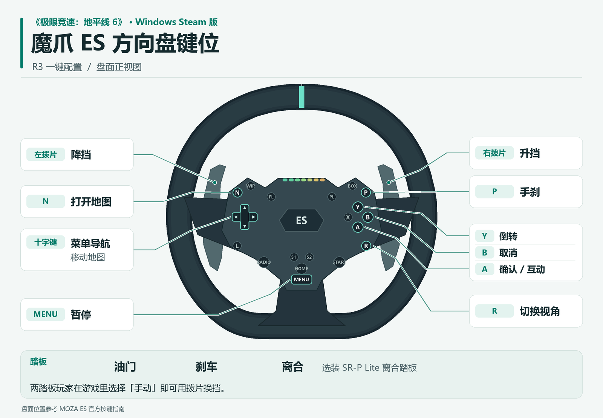

# 魔爪 R3 + ES 的《地平线 6》一键配置

适用于 Windows Steam 版《极限竞速：地平线 6》，配合魔爪 R3、ES 方向盘和 SR-P Lite 踏板使用。支持 R3 的原生模式（`346E:0005`）和地平线兼容模式（`346E:0015`）。

## 安装

1. 解压整个安装包。连接并开启 R3，完全退出游戏。
2. 双击解压目录里的 `Install.cmd`。安装器会找到 Steam 游戏、备份需要改动的文件，并安装这套键位。
3. 看到「已切换到新键位」后，从 Steam 启动游戏，直接进自由驾驶试用。

如果安装器提示需要进游戏选择方案，或进游戏后还在用旧键位，打开「设置 → 控制 → 改变输入映射 → 方向盘」。在「配置」一栏切到最左侧。这个槽位的名字可能显示为空白，键位列表里可以用「切换视角 = 按钮 35」确认。

安装程序以当前 Windows 用户身份离线运行。启动器仅为本次 PowerShell 进程使用 `RemoteSigned`。可用文本编辑器查看 `Install.ps1`，键位和备用力反馈文件在 `presets` 文件夹。

用 `-Check` 可先检查安装条件。自动查找失败时，在解压目录打开命令提示符，用 `-GamePath` 指定包含 `media` 文件夹的游戏目录。

```bat
Install.cmd -Check
Install.cmd -GamePath "D:\SteamLibrary\steamapps\common\ForzaHorizon6"
```

如果 Windows 阻止运行下载的未签名脚本，可以先查看源码。确认来源可信后，右键原始 ZIP，打开「属性」，勾选「解除锁定」，再重新解压。受单位策略管理的电脑请联系管理员。若提示无法写入游戏，请检查当前 Windows 用户是否对 Steam 游戏库有写入权限。 [Microsoft PowerShell 执行策略说明](https://learn.microsoft.com/zh-cn/powershell/module/microsoft.powershell.core/about/about_execution_policies)

## 进游戏验证

进入自由驾驶后，试一下这些操作：

- 踩下并松开油门、刹车，确认响应正常，松开时归零。
- 在手动挡下用拨片升挡、降挡。
- 开车时按 **Y** 倒转，再按 **A** 确认继续。
- 打开菜单，用十字键移动选项。

### 建议另存一份

试顺手后，可以在方向盘设置里把这套键位另存到空的自定义槽，例如「自定义方向盘 1」，以后切换方案时方便找回。这一步可以等试完再做。

## ES 方向盘键位图



**离合**预绑在第三块踏板上，游戏显示为「轴 7」。加装 SR-P Lite 离合踏板后，可在游戏里选「手动挡＋离合器」。双踏板玩家选普通「手动挡」，就可以用左右拨片换挡。 [魔爪 R3 踏板说明](https://us.mozaracing.com/pages/r3-racing-wheel-and-pedals-for-pc)

盘面位置参考魔爪的 ES 示意图。 [魔爪官方按键指南](https://support.mozaracing.com/en/support/solutions/articles/70000679639-button-numbering-guide)

## 力反馈

基座的力反馈强度、阻尼等参数继续用你在 Pit House 选的预设。安装器只在游戏缺少当前设备 ID 对应的力反馈条目时补上这一项。原生模式通常已由游戏自带。

## 恢复安装前的配置

完全退出游戏。安装备份位于游戏目录的 `media\FH6-MOZA-R3-backups\<时间戳>`。把该次备份里实际存在的 ZIP 放回 `media`。如果备份里还有 `LastUsedProfile`，按安装程序显示的原路径恢复它，再启动游戏。
